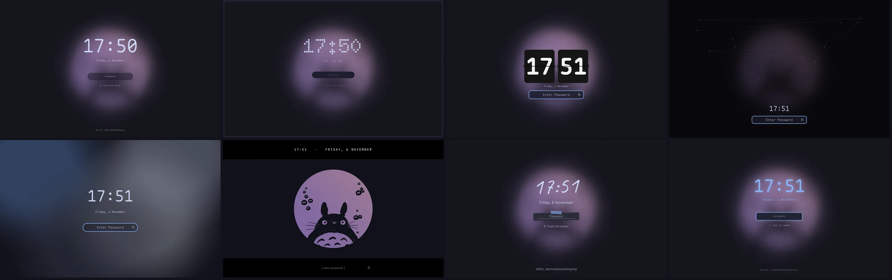

# Omarchy Lock Designs

[🇷🇺 Русский](README.ru.md)

22 designs for the [Omarchy](https://omarchy.org) lock screen. Authentication is untouched: password,
PAM and fingerprint are the stock `omarchy.lock` service — only the view is swapped.



<!-- Demo video: repo-videos/omarchy-lock-designs.mp4 — drag it here when editing this file on GitHub -->

classic (stock), zen, dock, island, split, sheet, card, cinema, poster, editorial, analog, flip, ring,
calendar, terminal, neon, system, music, aurora, rain, constellation, dotmatrix. All of them take their colours and
font from the active Omarchy theme (`dotmatrix` uses its signature pure `#000000` bezel, `Doto` Bold LED clock,
`Space Mono` uppercase labels, circular LED password dots and `#d71921` failure state).

## Install

```sh
omarchy plugin add https://github.com/KamradSmeshnyavy/omarchy-lock-designs --enable
omarchy restart shell
echo '{"design": "flip"}' > ~/.config/omarchy/lock-design.json
```

Preview a design without locking (Esc or click closes it):

```sh
omarchy-shell lock previewDesign flip
```

Back to the stock lock: `omarchy plugin enable omarchy.lock`.


## Requirements

Omarchy 4 (Quattro) with its shell. Tested on Omarchy 4.0.6 with Quickshell 0.3.2.

- Authentication is the stock Omarchy PAM flow — nothing extra to install.
- DOT-MATRIX designs use the fonts shipped with the [Customizer](https://github.com/KamradSmeshnyavy/omarchy-customizer) (Doto, Space Grotesk, Space Mono); without them they fall back to the Omarchy font.

## Uninstall

```sh
omarchy plugin enable omarchy.lock      # switch back to the stock one first
omarchy plugin remove kamradsmeshnyavy.lock
omarchy restart shell
```

Your settings stay in `~/.config/omarchy/lock-design.json` — delete them by hand if you don't need them.

## Safety

- `Service.qml` is the stock one with no changes to the auth logic. The edits are marked `// design:` —
  `LockView` is replaced with `LockHost` in two places, plus the `previewDesign` IPC and Esc to close a preview.
- A design sees exactly what the stock `LockView` sees: the state, and the typed text it hands back
  through the `submitPassword` signal.
- `LockHost` falls back to the stock `LockView` if a design fails to load, is not found, or doesn't
  register its password field within 0.5 s. You never end up on a screen without a password field.
- The clone inherits the `authentication` capability from `omarchy.lock`, so the shell isolates it the
  same way.
- If something breaks while locked: switch to a TTY (Ctrl+Alt+F3) and run
  `omarchy plugin enable omarchy.lock` or `loginctl unlock-session`.

## Settings — `~/.config/omarchy/lock-design.json`

The file is watched and applied immediately.

| Key | Default | |
|---|---|---|
| `design` | `classic` | design id |
| `clock24` | `true` | 24-hour clock |
| `showSeconds` | `false` | seconds |
| `showDate` | `true` | date |
| `wallpaperBlur` | `1` | wallpaper blur, 0–1 |
| `wallpaperDim` | `0` | wallpaper dim, 0–0.9 |
| `reduceMotion` | `false` | no animations (aurora, rain, the second hand) |
| `ownerMessage` | `Hello, $USER` | greeting (Russian: `Привет, $USER`) |
| `lang` | — | `en` / `ru`; otherwise `lang` from `~/.config/omarchy/customizer.json`, then `$LANG` |
| `avatar` | `~/.face` | avatar image; without one, the first letter of the user name |

## Your own design

`~/.config/omarchy/lock-designs/Mine.qml`, selected as `my:Mine.qml`:

```qml
import QtQuick
import "../plugins/kamradsmeshnyavy.lock/designs"

DesignBase {
  id: root
  field: pw                       // required, otherwise the stock view is shown
  Wallpaper { anchors.fill: parent; host: root }
  Text { text: root.time; color: root.fg; font.family: root.font; font.pixelSize: 80 }
  PasswordField { id: pw; host: root; anchors.centerIn: parent }
}
```

`DesignBase` provides `time`, `hours`, `minutes`, `dateText`, `now`, `greeting`, `userName`, `lang`, `tr()`, the colours
`bg fg accent muted`, `font`, `withAlpha()`, `opt(key, def)` and a `preview` flag. Test it with
`omarchy-shell lock previewDesign my:Mine.qml`.

## Files

| File | |
|---|---|
| `LockHost.qml` | loads a design, falls back to the stock view |
| `designs/designs.json` | registry: `id`, `file`, `name`, `description`, `tags` |
| `designs/*.qml` | the designs and shared parts: `DesignBase`, `PasswordField`, `Wallpaper`, `Avatar` |

Rebasing onto a new Omarchy: `diff -u $OMARCHY_PATH/shell/plugins/lock/Service.qml Service.qml` and carry
the `// design:` blocks over.

In [my dotfiles](https://github.com/KamradSmeshnyavy/dotfiles) the design and every setting are picked in
the Customizer overlay, with previews rendered in the current theme.

## With the Customizer

[omarchy-customizer](https://github.com/KamradSmeshnyavy/omarchy-customizer) is one overlay (Super+Shift+T) with live preview for this plugin's settings and
the rest of the look & feel: themes, wallpapers, Hyprland animations, transparency, blur, screen shaders.
Install it next to this plugin (it finds the other companions on its own):

```sh
omarchy plugin add https://github.com/KamradSmeshnyavy/omarchy-customizer --enable
```

## Style designs

`style-flat`, `style-glass`, `style-fluent`, `style-paper`, `style-neumorph`, `style-brutal`, `style-retro`, `style-neon` —
the DOT-MATRIX layout (big clock, date, password field with dots, fingerprint hint, motto) in the finish of a Customizer
style: one `designs/StyleLock.qml` with `look`, tiny wrappers `designs/Style<Look>.qml`. Colours come from the theme.

## License

MIT. Based on `omarchy.lock` from [Omarchy](https://github.com/basecamp/omarchy) (MIT, © David Heinemeier
Hansson). Inspired by [omarchy-lock-explorer](https://github.com/SirJul1337/omarchy-lock-explorer); no
code from it is used.
