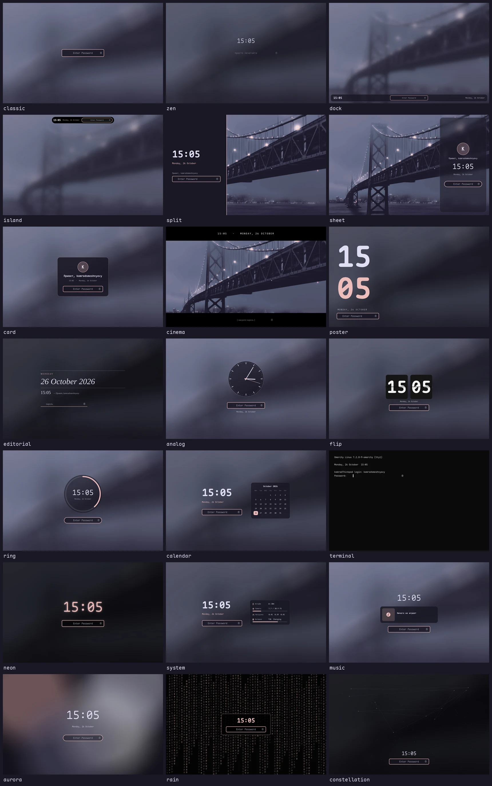

# Omarchy Lock Designs

[🇬🇧 English](README.md)

21 дизайн экрана блокировки [Omarchy](https://omarchy.org). Аутентификация не тронута: пароль, PAM и
отпечаток — стоковый сервис `omarchy.lock`, заменён только вид.



classic (сток), zen, dock, island, split, sheet, card, cinema, poster, editorial, analog, flip, ring,
calendar, terminal, neon, system, music, aurora, rain, constellation. Цвета и шрифт — из текущей темы.

## Установка

```sh
omarchy plugin add https://github.com/KamradSmeshnyavy/omarchy-lock-designs --enable
omarchy restart shell
echo '{"design": "flip"}' > ~/.config/omarchy/lock-design.json
```

Посмотреть дизайн без блокировки (Esc или клик — закрыть):

```sh
omarchy-shell lock previewDesign flip
```

Вернуть стоковый экран: `omarchy plugin enable omarchy.lock`.

Проверено на Omarchy 4.0.6 и Quickshell 0.3.2.

## Безопасность

- `Service.qml` — стоковый, логика аутентификации не менялась. Правки помечены `// design:`: `LockView`
  заменён на `LockHost` в двух местах, добавлены IPC `previewDesign` и закрытие превью по Esc.
- Дизайн видит только то же, что стоковый `LockView`: состояние и введённый текст, который он отдаёт
  сигналом `submitPassword`.
- `LockHost` показывает стоковый `LockView`, если дизайн не загрузился, не найден или за 0,5 с не назначил
  поле пароля. Экран без ввода пароля не остаётся.
- Клон наследует капабилити `authentication` от `omarchy.lock`: шелл изолирует его так же.
- Если что-то сломалось на заблокированном экране: TTY (Ctrl+Alt+F3) →
  `omarchy plugin enable omarchy.lock` или `loginctl unlock-session`.

## Настройки — `~/.config/omarchy/lock-design.json`

Файл читается на лету.

| Ключ | Умолч. | |
|---|---|---|
| `design` | `classic` | id дизайна |
| `clock24` | `true` | 24-часовой формат |
| `showSeconds` | `false` | секунды |
| `showDate` | `true` | дата |
| `wallpaperBlur` | `1` | размытие обоев 0–1 |
| `wallpaperDim` | `0` | затемнение обоев 0–0.9 |
| `reduceMotion` | `false` | без анимаций (aurora, rain, секундная стрелка) |
| `ownerMessage` | `Привет, $USER` | приветствие (по-английски — `Hello, $USER`) |
| `lang` | — | `en` / `ru`; иначе `lang` из `~/.config/omarchy/customizer.json`, затем `$LANG` |
| `avatar` | `~/.face` | картинка аватара; нет — первая буква имени |

## Свой дизайн

`~/.config/omarchy/lock-designs/Mine.qml`, выбирается как `my:Mine.qml`:

```qml
import QtQuick
import "../plugins/kamradsmeshnyavy.lock/designs"

DesignBase {
  id: root
  field: pw                       // обязательно: иначе покажется стоковый экран
  Wallpaper { anchors.fill: parent; host: root }
  Text { text: root.time; color: root.fg; font.family: root.font; font.pixelSize: 80 }
  PasswordField { id: pw; host: root; anchors.centerIn: parent }
}
```

В `DesignBase` есть `time`, `hours`, `minutes`, `dateText`, `now`, `greeting`, `userName`, `lang`, `tr()`, цвета
`bg fg accent muted`, `font`, `withAlpha()`, `opt(key, def)` и флаг `preview`. Проверка:
`omarchy-shell lock previewDesign my:Mine.qml`.

## Файлы

| Файл | |
|---|---|
| `LockHost.qml` | загрузчик дизайна с фолбэком |
| `designs/designs.json` | реестр: `id`, `file`, `name`, `description`, `tags` |
| `designs/*.qml` | дизайны и общие части: `DesignBase`, `PasswordField`, `Wallpaper`, `Avatar` |

Обновление Omarchy: `diff -u $OMARCHY_PATH/shell/plugins/lock/Service.qml Service.qml` — перенести блоки
`// design:`.

В [моих dotfiles](https://github.com/KamradSmeshnyavy/dotfiles) дизайн и настройки выбираются в оверлее
Customizer, превью рендерятся в цветах текущей темы.

## Вместе с Customizer

[omarchy-customizer](https://github.com/KamradSmeshnyavy/omarchy-customizer) — один оверлей (Super+Shift+T) с живым предпросмотром для настроек этого
плагина и всего остального оформления: темы, обои, анимации Hyprland, прозрачность, блюр, шейдеры экрана.
Одна команда ставит его и предлагает этот плагин и остальные:

```sh
curl -fsSL https://raw.githubusercontent.com/KamradSmeshnyavy/omarchy-customizer/main/install.sh | bash
```

## Лицензия

MIT. Основано на `omarchy.lock` из [Omarchy](https://github.com/basecamp/omarchy) (MIT, © David Heinemeier
Hansson). Идея — [omarchy-lock-explorer](https://github.com/SirJul1337/omarchy-lock-explorer), код оттуда
не используется.
